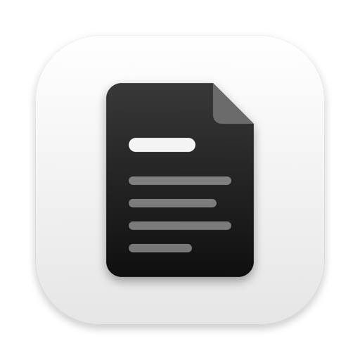
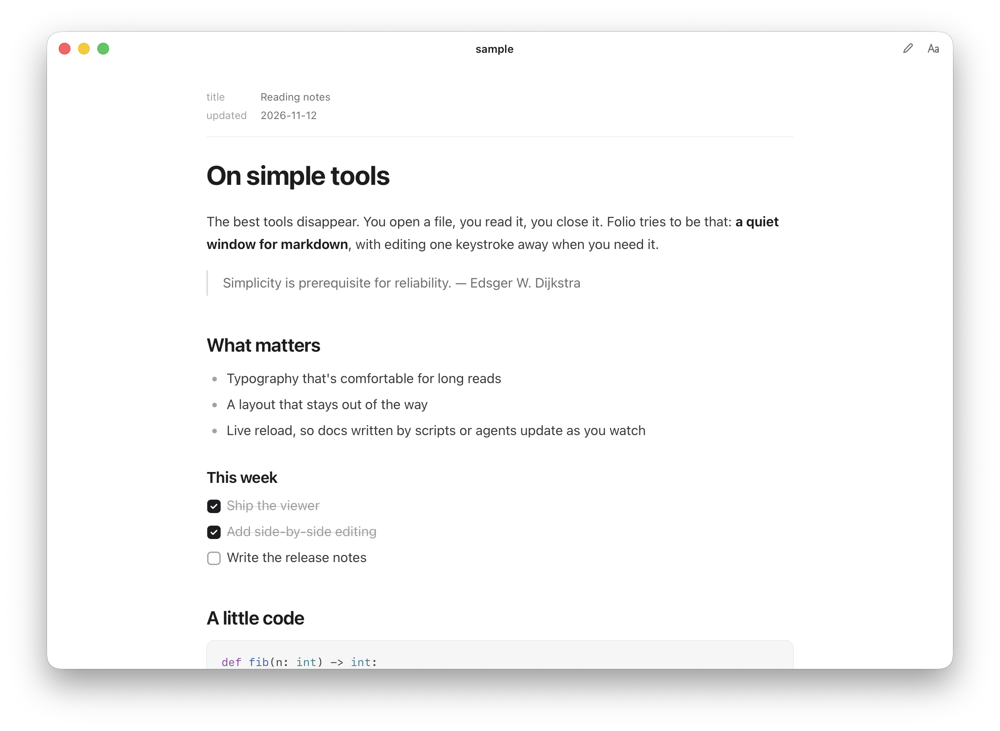
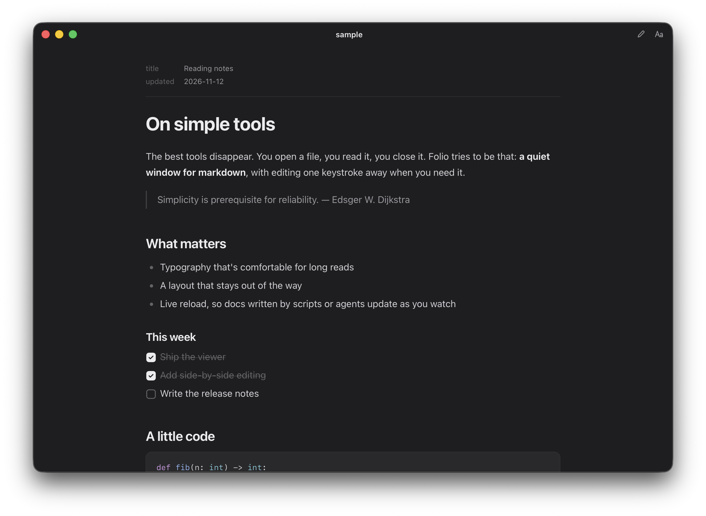
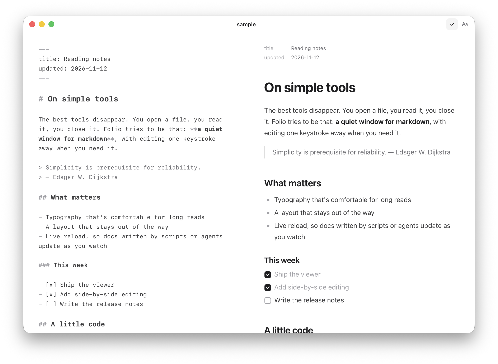

<p align="center">
  
</p>

<h1 align="center">Folio</h1>

<p align="center">
  A quiet little markdown viewer for macOS.<br>
  Open a <code>.md</code> file, read it. Press <kbd>⌘E</kbd> if you want to edit it.
</p>

<p align="center">
  
  
</p>

---

## Why

Most markdown apps want to be your notes system: vaults, sidebars, tags, sync. Folio is closer to Preview: one window per file and nothing else on screen. It's for reading READMEs, docs, specs, and anything an agent just wrote for you.

## Features

- **Clean reading:** comfortable measure and spacing, with system light/dark mode
- **Full GFM:** tables, task lists, strikethrough, and autolinks
- **Code:** syntax highlighting with a copy button on every block
- **Math:** `$inline$` and `$$display$$` LaTeX via KaTeX
- **Frontmatter:** YAML frontmatter shows as subtle metadata instead of raw text
- **Live reload:** if the file changes on disk, the window updates within about a second
- **Edit in place:** <kbd>⌘E</kbd> opens a markdown editor with autosave. <kbd>⌘3</kbd> shows editor and preview side by side
- **Clickable checkboxes:** ticking a task in the reader writes `[x]` back to the file
- **Smart links:** links to other `.md` files open in Folio, web links open in your browser, and relative images just work
- **Small and native:** about 200 KB of Swift wrapping a WebKit view. No Electron

<p align="center">
  
</p>

## Shortcuts

| Action | Keys |
| --- | --- |
| Toggle editing | <kbd>⌘E</kbd> |
| Read / Edit / Side by side | <kbd>⌘1</kbd> <kbd>⌘2</kbd> <kbd>⌘3</kbd> |
| Find | <kbd>⌘F</kbd> |
| Bigger / smaller / reset text | <kbd>⌘+</kbd> <kbd>⌘−</kbd> <kbd>⌘0</kbd> |
| Bold / italic / link (editor) | <kbd>⌘B</kbd> <kbd>⌘I</kbd> <kbd>⌘K</kbd> |
| New / Open / Save | <kbd>⌘N</kbd> <kbd>⌘O</kbd> <kbd>⌘S</kbd> |
| Reveal in Finder | <kbd>⇧⌘R</kbd> |

The **Aa** button switches between Sans, Serif and Mono and between Narrow, Medium and Wide page widths. The setting applies to every window.

## Install

### Download

Grab `Folio.zip` from the [latest release](../../releases/latest), unzip it, and drag **Folio.app** into `/Applications`.

The app is ad-hoc signed, not notarized, so the first launch needs one extra step. Either right-click the app → **Open**, or run:

```sh
xattr -dr com.apple.quarantine /Applications/Folio.app
```

### Build from source

Requires macOS 13+, Xcode command line tools and Node.

```sh
git clone https://github.com/NathanYJiang/folio.git
cd folio
npm install
./build.sh install   # builds build/Folio.app and copies it to /Applications
```

`./build.sh` without `install` only builds.

### Make it the default

Right-click any `.md` file → **Get Info** → **Open with: Folio** → **Change All…**

## How it's built

```
src/mac/main.swift    AppKit shell: windows, menus, file IO, drag & drop
src/mac/Info.plist    bundle + document type registration
src/web/              UI (HTML/CSS/JS) bundled with esbuild
scripts/make-icon.swift  draws the app icon
build.sh              bundle → compile → assemble .app → codesign
```

Rendering uses [marked](https://github.com/markedjs/marked), [highlight.js](https://highlightjs.org) and [KaTeX](https://katex.org), sanitized with [DOMPurify](https://github.com/cure53/DOMPurify). The editor is [CodeMirror 6](https://codemirror.net).

To preview the UI in a regular browser, open `build/web/index.html`. It falls back to a mock bridge with sample content.

## License

[MIT](LICENSE)
